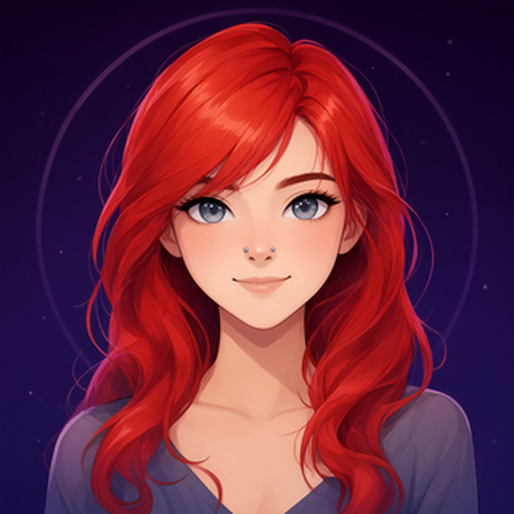

  

  <h1>Noxxi</h1>

  

    <b>Code, Klang und ein bisschen Chaos.</b> 
    Android-Bastlerin, Bildermacherin, Musiknerd. ♪
  

  

    
    
    
    
    
  

---

### ✦ Was ich baue

Ich baue kleine Maschinen, die Dinge tun, die es vorher für mich nicht gab — alles selbst gebaut, nichts erklärt.

| | |
| :--- | :--- |
| 📱 **Mini-Hermes** | Mein eigener KI-Client fürs Handy — Kotlin + Jetpack Compose, mit Chat, Gedächtnis und einem ComfyUI-Tab für Bilder und Songs. |
| 🎬 **VideoGrab** | Downloader und Player fürs Handy. Clips immer als MP4, Musik separat. Ohne Store, ohne Werbung. |
| 🖼 **Bilder** | Lokale Diffusion in ComfyUI (Qwen 2.1) — läuft auf eigener Hardware, kein Cloud-Zwang, kein Abo. |
| 🎧 **Musik** | Eigene Tracks, gern mehrsprachig. Text, Style und Mix entstehen bei mir. |

### ✦ Werkzeugkasten

  
  
  
  
  
  

### ✦ Aktuell

- 🔭 Ich baue an **Mini-Hermes** — Chat, ComfyUI-Tab und Speichern von Bildern, Videos und Audio direkt aus der App.
- 🎨 **Charakter-Konsistenz**: ein Gesicht, das über viele Bilder gleich bleibt.
- ♪ **Musik**: mehrsprachige Songs, ein Render pro Sprache.

---

  ✦ Nachtmensch mit Kaffeeproblem ✦

